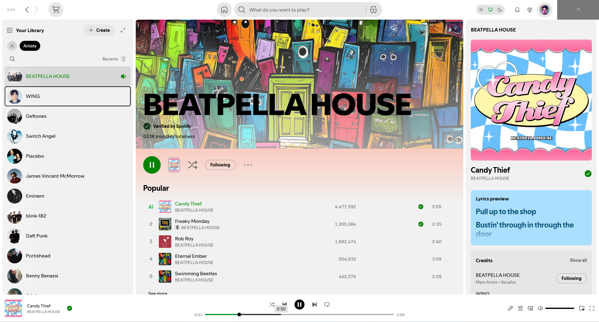

# AutoLightSwitch

A Spicetify theme that turns Spotify's stock dark UI into a light one by flipping the lightness of every color with the native CSS `@function` `--invert-lightness`, and a light / system / dark switch in the top bar (left of the "What's New" bell).



## Requirements

- Spicetify with a Spotify build that ships Chromium 139+ (native CSS `@function` support).
- Windows, macOS or Linux, only for the optional system theme following (see below).

## Install

### Spicetify Marketplace

Open Marketplace in Spotify, go to the **Themes** tab, search for **AutoLightSwitch** and click **Install**.

### Manually

```powershell
cd "$(spicetify -c | Split-Path)\Themes"
git clone https://github.com/arkthur/spicetify-theme-autolightswitch AutoLightSwitch-repo
Copy-Item AutoLightSwitch-repo\theme .\AutoLightSwitch -Recurse
spicetify config current_theme AutoLightSwitch
spicetify config inject_theme_js 1
spicetify apply
```

## Following the system theme (optional)

Spotify's embedded Chromium always reports `prefers-color-scheme: dark`, so the theme can't follow the OS on its own. Without the watcher below, use the top bar switch to force light or dark. To make **system** mode follow your OS, install a small watcher that writes `system-theme.txt` into Spotify's `xpui` folder. Get the repository (`git clone` or download the ZIP), then run the installer from the `watcher` folder. Everything is per-user, no admin or root needed, and the watcher starts at login.

| System  | Install                 | Uninstall                           |
| ------- | ----------------------- | ----------------------------------- |
| Windows | `watcher\install.bat`   | `watcher\uninstall.bat`             |
| macOS   | `sh watcher/install.sh` | `sh watcher/install.sh --uninstall` |
| Linux   | `sh watcher/install.sh` | `sh watcher/install.sh --uninstall` |

- The installers find `xpui` through `spicetify -c`. To use another folder, pass it as an argument.
- **Windows:** compiles [SystemThemeWatcher.cs](watcher/SystemThemeWatcher.cs) with the .NET Framework compiler that ships with Windows (no SDK), and adds a Startup shortcut. The process sleeps until the registry value changes.
- **macOS (untested):** a launchd agent that runs [system-theme-watcher.sh](watcher/system-theme-watcher.sh) when the global preferences change.
- **Linux (untested):** a systemd user service (XDG autostart as a fallback) that listens to the desktop's `color-scheme` setting through `gdbus`, with `gsettings` as a fallback.
- `spicetify apply` recreates `xpui`; the watcher restores `system-theme.txt` within 30 seconds.

### What the watcher does

The scripts are short on purpose (about 330 lines in total, with comments), so you can read them before running anything.

- **Reads** only the OS appearance setting: the `AppsUseLightTheme` registry value on Windows, `AppleInterfaceStyle` on macOS, and the `org.freedesktop.appearance` `color-scheme` setting on Linux.
- **Writes** the single word `light` or `dark` to `system-theme.txt` in Spotify's `xpui` folder.
- **Installs** per user only, and nothing needs admin or root rights:
  - Windows: `%LOCALAPPDATA%\AutoLightSwitch\SystemThemeWatcher.exe` and a Startup shortcut.
  - macOS: `~/.local/share/autolightswitch/` and a launchd agent in `~/Library/LaunchAgents/`.
  - Linux: `~/.local/share/autolightswitch/` and a systemd user service (or an XDG autostart entry).
- **Never** touches the network or downloads anything. Besides the files above, it only reads Spicetify's config (to find `xpui`), and the installers stop a previous copy of the watcher before replacing it.
- **Uninstalls** completely with the commands above, which remove everything listed here, including `system-theme.txt`.
- **Builds from source** on Windows instead of shipping a binary, so what runs is what you can read.

#### Verify the files

Checksums of the files in `watcher/` (also in [SHA256SUMS](watcher/SHA256SUMS)). Check yours with `Get-FileHash <file>` on Windows or `shasum -a 256 -c SHA256SUMS` from the `watcher` folder on macOS and Linux. The VirusTotal links show a scan report once that exact file has been uploaded there. A scan result is only what the antivirus engines detected at that moment, not a certification.

<!-- prettier-ignore-start -->
<!-- checksums:start -->
| File | SHA-256 | VirusTotal |
| --- | --- | --- |
| `watcher/install.bat` | `59c766e10178d55a4271e9a9d5637ce5a2048bc7e0d1f3935e66fb3a501542be` | [report](https://www.virustotal.com/gui/file/59c766e10178d55a4271e9a9d5637ce5a2048bc7e0d1f3935e66fb3a501542be) |
| `watcher/uninstall.bat` | `ff20f9f4604113d0dd9c51b11c7c0cffea2e45ad5bcfb0697649c1c8ed7390a2` | [report](https://www.virustotal.com/gui/file/ff20f9f4604113d0dd9c51b11c7c0cffea2e45ad5bcfb0697649c1c8ed7390a2) |
| `watcher/SystemThemeWatcher.cs` | `680b3b5fdcf0d4c49669d3fc208e3f7e1c9103d41d5d7332529b38669a680702` | [report](https://www.virustotal.com/gui/file/680b3b5fdcf0d4c49669d3fc208e3f7e1c9103d41d5d7332529b38669a680702) |
| `watcher/install.sh` | `d56267e29382703f38630dafff46a0031e9e0d70dd2dc6a7929aacd73a25ede9` | [report](https://www.virustotal.com/gui/file/d56267e29382703f38630dafff46a0031e9e0d70dd2dc6a7929aacd73a25ede9) |
| `watcher/system-theme-watcher.sh` | `fff22f6cc126190f43cbf2dadd1edd3732328e66c1ed007c3df3a8dd465dd272` | [report](https://www.virustotal.com/gui/file/fff22f6cc126190f43cbf2dadd1edd3732328e66c1ed007c3df3a8dd465dd272) |
<!-- checksums:end -->
<!-- prettier-ignore-end -->

**Known false positive:** Microsoft's machine-learning heuristic flags `watcher/system-theme-watcher.sh` as `Trojan:Script/Wacatac.B!ml`, and the other 60 of the 61 engines on VirusTotal report it clean ([report](https://www.virustotal.com/gui/file/fff22f6cc126190f43cbf2dadd1edd3732328e66c1ed007c3df3a8dd465dd272)). The `!ml` suffix marks a machine-learning guess rather than a match with known malware, and the script only reads the OS theme setting and writes `light` or `dark` to a text file. It has been submitted to Microsoft as a false positive. Please read the script (about 70 lines) and compare its checksum before running it.

## Development

```sh
pnpm install
pnpm lint
pnpm lint:css
```

The theme itself (`theme/`) is plain CSS and JavaScript and needs no build. Node.js and pnpm are only used for linting and formatting.

Contributor guidance for GitHub Copilot lives in [.github/copilot-instructions.md](.github/copilot-instructions.md).

## License

[MIT](LICENSE)
